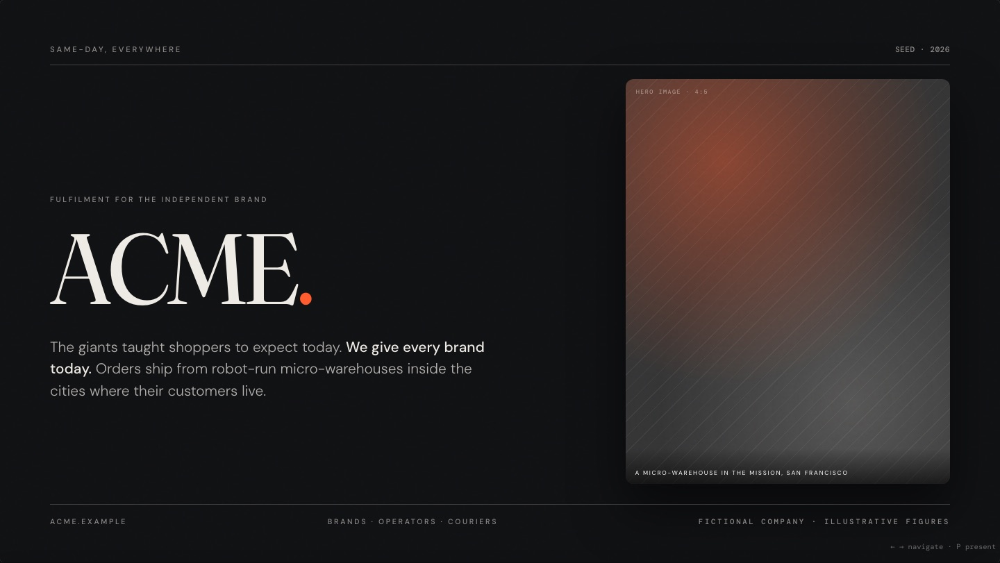
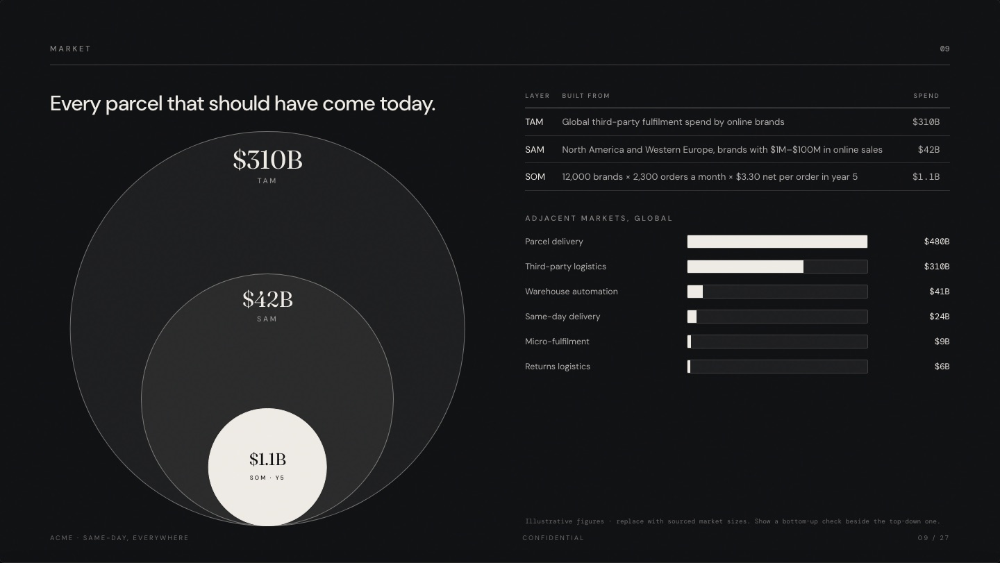
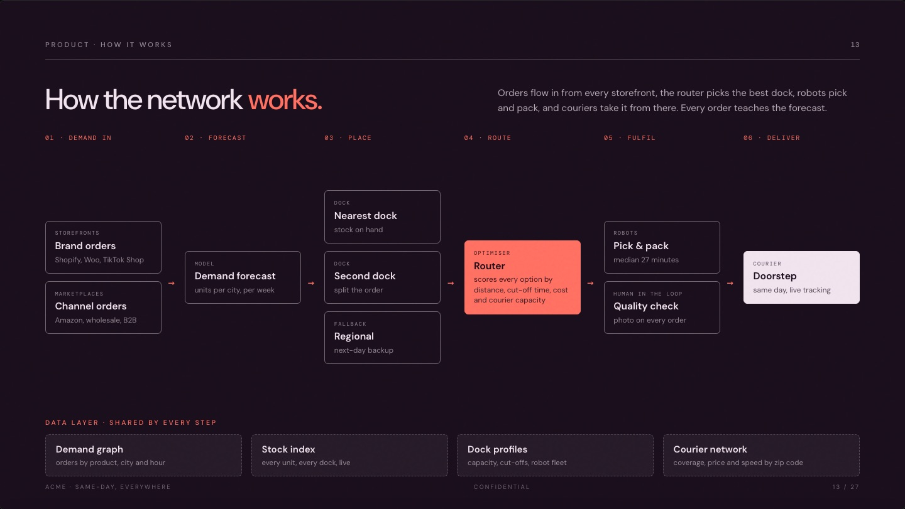
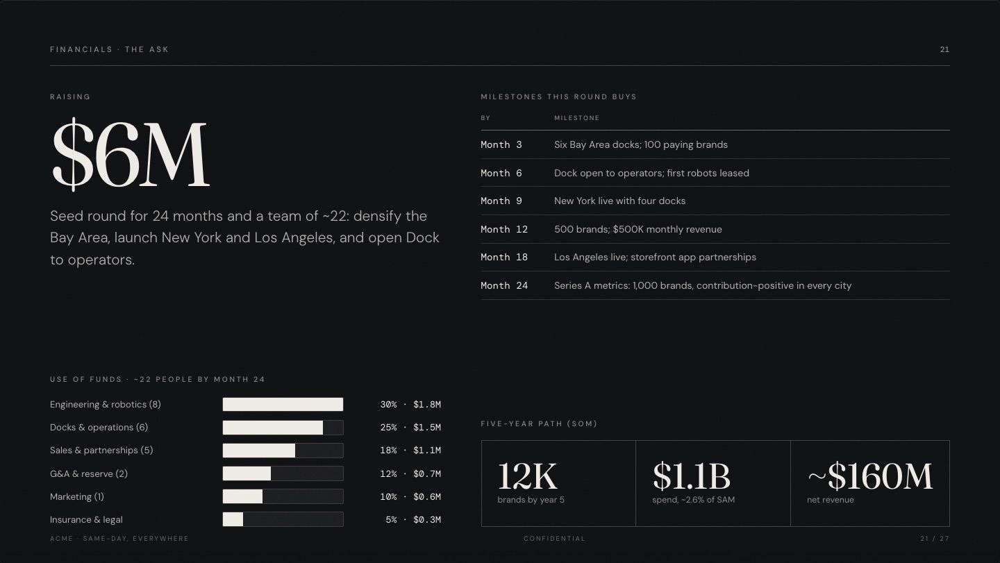
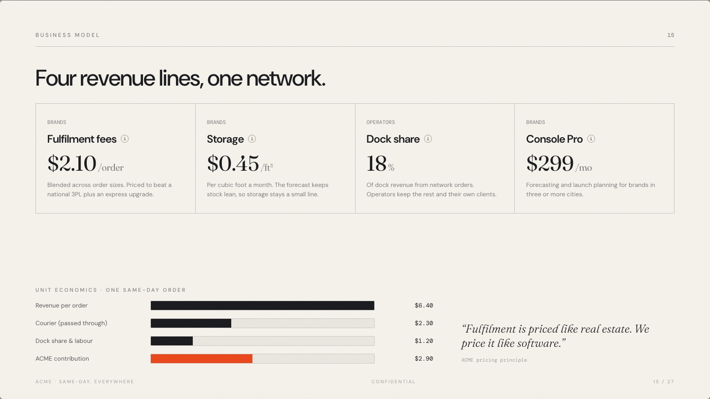

# Investor Deck

A browser-based investor deck you can make your own in an afternoon. Bring your startup and your design system; keep a story structure, layouts and presentation that already work.



The deck in this repo is for **ACME**, a fictional same-day fulfilment startup. Every name and number in it is illustrative. It exists to show every slide type working, so you (or your AI coding agent) can replace it with your company.

## What you get

- **27 slides in a proven order:** hook, opportunity, business, people, and the deal. Each slide has one job, documented in [docs/STORY.md](docs/STORY.md).
- **Two ways to view.** Scroll the deck like a document, or press **Present** (or `P`) for full-screen slides. Use `← →` to move and `Esc` to exit.
- **Copy for AI.** One click copies the whole deck as Markdown, with a brief that asks the investor's AI (ChatGPT, Claude, Gemini) for a summary, the strengths, the risks and the questions to ask you.
- **Palettes.** "Change colours" cycles through your brand's palettes, and sections move together.
- **Fluid layout.** Every slide is a 16:9 sheet sized in container units, so it looks the same on a laptop, a projector or a phone. Content fades up as each slide arrives.
- **Prints to PDF.** Print from the browser to get one slide per page.
- **No build step.** Plain HTML, CSS and JavaScript. Host the `deck/` folder anywhere.

| | |
|---|---|
|  |  |
|  |  |

## Make it yours

### With an AI coding agent (recommended)

Clone the repo, open it in Claude Code, Cursor, Codex or any agent that reads `AGENTS.md`, and say:

> Use my design system and my startup and create this new deck.
> My company: [paste a description, or point to your old deck, one-pager or website].
> My design system: [point to your CSS variables, Tailwind config, Figma tokens, brand book or logo].

In Claude Code you can also type `/investor-deck`. The agent follows [the skill](.claude/skills/investor-deck/SKILL.md):
1. It reads your material and maps it onto the story.
2. It applies your colours, fonts and logo.
3. It rewrites every slide.
4. It checks that every slide fits.

It never invents a figure: anything it doesn't know is highlighted on the slide as a `todo` for you to fill.

For a head start, fill in [inputs/company.md](inputs/company.md) and [inputs/design-system.md](inputs/design-system.md) first.

### By hand

1. **Brand:** palettes in `deck/brand.js`; fonts, wordmark and finish in `deck/brand.css`; the font link in `deck/index.html`. See [docs/DESIGN-SYSTEM.md](docs/DESIGN-SYSTEM.md).
2. **Content:** edit the slides in `deck/index.html`, following the jobs and writing rules in [docs/STORY.md](docs/STORY.md). The building blocks are in [docs/COMPONENTS.md](docs/COMPONENTS.md).
3. **Images:** replace the placeholder art (class `ph`) with your images in `deck/assets/`.
4. **Check:** run `npm run check`.

## Run it

```bash
npm run dev            # http://localhost:4000, no install needed
```

To check layouts and render the social preview, install the dev tools once:

```bash
npm install && npx playwright install chromium
npm run check          # every slide fits, no errors; screenshots in shots/
npm run og             # renders deck/assets/og-image.png from the cover
```

## Deploy

The `deck/` folder is a static site:
- **Vercel:** import the repo; `vercel.json` serves `deck/` with no build.
- **Netlify, Cloudflare Pages or GitHub Pages:** set the publish directory to `deck`.
- **Inside an existing site:** copy `deck/` into the site's public folder, for example `public/deck/`.

The deck sets `noindex` so search engines skip it. Share the link with the people you choose.

## Repo map

```
deck/            the deck: index.html (content), brand.css + brand.js (design system),
                 deck.css + deck.js (engine, don't edit), assets/
docs/            STORY.md, DESIGN-SYSTEM.md, COMPONENTS.md
inputs/          briefs to fill in: company.md, design-system.md
scripts/         serve.mjs, check.mjs, og.mjs
.claude/skills/  the investor-deck skill (the workflow every agent follows)
AGENTS.md        the agent guide; CLAUDE.md points to it
```

## Credits

The structure, layouts and engine come from the Renaissance seed deck.
